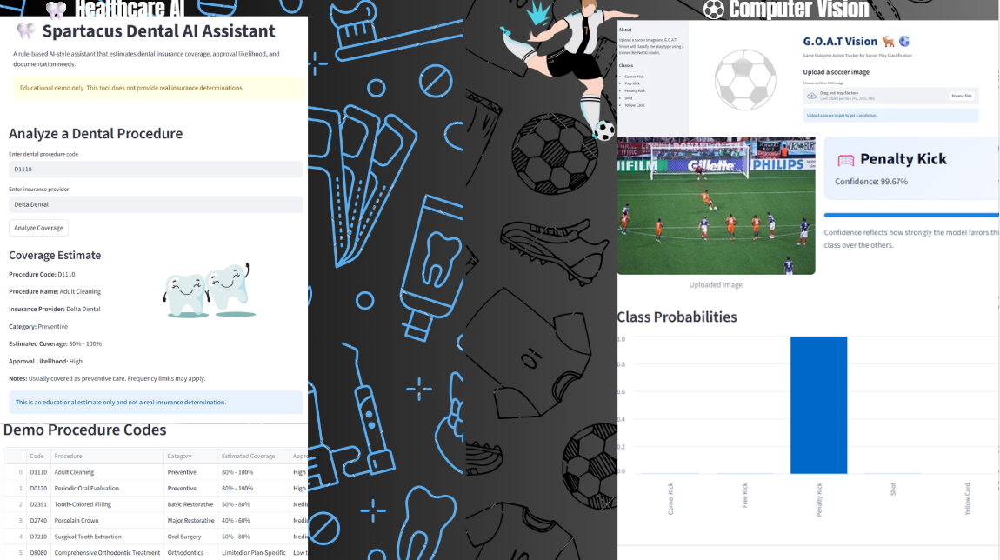
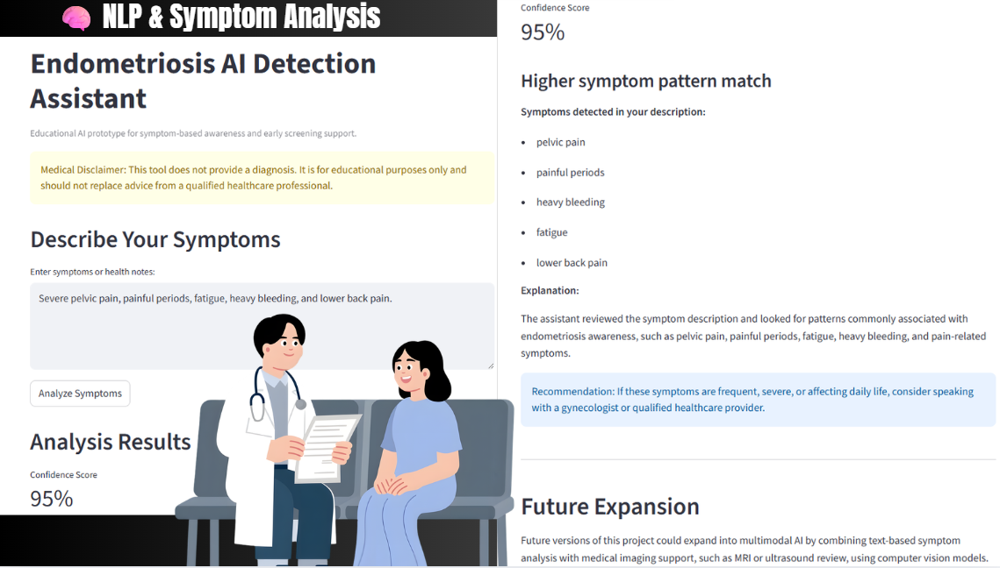

# Samira Gevara | Applied AI Portfolio

Python • Computer Vision • AI Applications • Practical Problem Solving

## About Me

I’m developing my skills in Python and applied AI by building projects that explore practical problems in food management, healthcare information, and sports analytics.

My professional background includes team leadership, multi-location operations, and supporting users in educational environments. I bring that experience into technology through a customer-focused approach, clear communication, and a willingness to investigate problems and keep learning.

This portfolio documents my work at different stages—from early rule-based prototypes to a trained image classifier and a collaborative AI capstone.

---

## Projects at a Glance

| Project | Focus | Current Stage |
|---|---|---|
| ⚽ GOATVision | Computer vision and transfer learning | Working image-classification prototype |
| 🥫 SmartPantry AI | Recipe recommendations and AI assistant integration | Collaborative capstone in development |
| 🦷 Spartacus | Dental insurance information and application logic | Working rule-based prototype |
| 🧠 Endometriosis | Text input and symptom awareness | Early-stage keyword-based prototype |

---

## Technical Skills & Tools

My experience comes from hands-on projects and continued learning.

- **Programming:** Python, SQL fundamentals
- **Data:** Data cleaning and normalization, JSON, Python dictionaries
- **Computer Vision:** PyTorch, torchvision, ResNet50, transfer learning
- **Application Development:** Streamlit, API integration, rule-based logic
- **Development Tools:** Git, GitHub, Google Colab, Jupyter Notebooks
- **Development Practices:** Debugging, testing, technical documentation, AI-assisted development

I’m continuing to build experience with LLM integration, natural language processing, and evaluating AI application outputs.

---

## Featured Projects

### ⚽ GOATVision — Soccer Play Classifier

A computer vision application that classifies soccer images into five play categories using ResNet50 transfer learning, PyTorch, and Streamlit.

**My work includes:**
- Curating and cleaning a custom soccer-image dataset.
- Developing and experimenting with the transfer-learning workflow.
- Evaluating model predictions and confusion between similar categories.
- Building an interface that displays predictions and class probabilities.

**Current stage:** Working prototype. The project reports 82.14% validation accuracy on a small dataset; broader generalization remains a limitation. Experimental video support classifies one extracted frame.

**Repository:** [GOATVision](https://github.com/samirag2010/GOATVision)

---

### 🥫 SmartPantry AI — Food Management Assistant

A collaborative capstone designed to combine pantry inventory, expiration and storage information, recall checks, and recipe recommendations.

**My contributions include:**
- Developing Python ingredient matching and normalization.
- Implementing weighted recipe ranking based on pantry coverage and expiration priority.
- Developing Spoonacular API requests and examining recipe responses.
- Comparing recipe APIs and LLM options, including usage costs.
- Working on AI assistant integration and assisting with development and testing across project components.

I am also taking responsibility for image recognition, which is planned and has not yet been implemented.

**Current stage:** In development. The recipe ranking baseline is rule-based, while AI assistant integration and broader application testing are ongoing.

This is a team project; the repository includes work contributed by multiple team members.

**Repository:** [SmartPantry AI](https://github.com/SmartPantry-AI/smartpantry-ai)

---

### 🦷 Spartacus — Dental Insurance Assistant

A Python and Streamlit prototype exploring a simpler way to present dental procedure information.

**My work includes:**
- Building the interactive interface.
- Organizing predefined procedure information in Python dictionaries.
- Separating lookup logic from the interface.
- Normalizing inputs and handling unsupported procedure codes.
- Displaying structured demonstration results and their limitations.

**Current stage:** Working rule-based prototype. Coverage ranges and approval categories are predefined demonstration values. Provider names do not change the results, and the application does not verify policies, calculate actual patient costs, or use an LLM.

**Repository:** [Spartacus](https://github.com/samirag2010/spartacus-dental-ai)

---

### 🧠 Endometriosis — Symptom Awareness Prototype

An early-stage Streamlit application exploring how text-based symptom descriptions can be organized into explainable awareness information.

**My work includes:**
- Building a text-input interface.
- Implementing weighted keyword matching.
- Displaying matched symptom terms and explanations.
- Including a medical disclaimer and guidance to consult a healthcare professional.

**Current stage:** Early prototype. The current implementation uses predefined keywords and rules rather than a trained NLP model. Its displayed confidence percentage is simulated and is not a clinically validated probability.

This project does not diagnose endometriosis. Future work includes improving text handling and evaluating more appropriate ways to communicate results.

**Repository:** [Endometriosis](https://github.com/samirag2010/Endometriosis-AI)

---

## Current Focus

- Integrating and testing the SmartPantry AI assistant.
- Improving project documentation and reproducibility.
- Strengthening Python, debugging, and software development fundamentals.
- Expanding my understanding of computer vision and language-based applications.
- Clearly evaluating and communicating what each prototype can and cannot do.

---

## Development Approach

I use projects to connect technical concepts with practical applications. My process includes investigating a problem, building a baseline, testing behavior, documenting limitations, and identifying the next improvement.

I use AI-assisted development tools for guidance and debugging while working to understand, execute, and verify the resulting code. Project-specific disclosures and supporting documentation are included where available.

---

## Contact

- **Email:** samirad2012@hotmail.com
- **GitHub:** https://github.com/samirag2010
- **LinkedIn:** https://www.linkedin.com/in/samira-gevara

---

## Portfolio Goal

I’m seeking entry-level technology opportunities where I can contribute my professional experience, foundational technical skills, and curiosity while learning from an experienced team.
